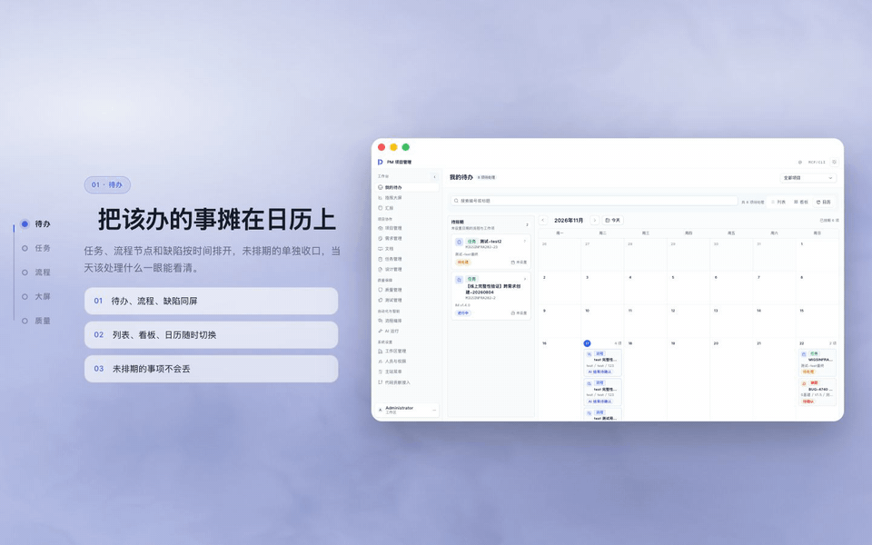

# Aurora PM · 项目管理与研发协作

Aurora PM 把项目计划、需求、任务、质量记录和交付进度放在同一个工作区。这个源码可见版本可以在本机从空数据库启动。源码允许查看、克隆和原样本地非商业试用，禁止未经书面许可修改或商用。完整范围见 [使用条款](LICENSE)。

[](apps/web/public/guides/product-tour/aurora-pm.mp4)

[观看或下载 MP4 演示](apps/web/public/guides/product-tour/aurora-pm.mp4)

## 本机启动

准备 macOS 或 Linux、Bun 1.4、Go 1.25 或以上、带 Compose v2 的 Docker、OpenSSL 和 curl。启动 Docker，在克隆所得目录的根目录运行以下命令。首次运行需要联网下载依赖和 PostgreSQL 镜像。

```sh
sh scripts/dev.sh
```

打开 [Aurora PM 本地首页](http://127.0.0.1:5188)，使用账号 `admin` 登录。在本机打开 `.local/credentials.env`，使用 `PM_BOOTSTRAP_ADMIN_PASSWORD` 对应的值。安装程序在首次运行时随机生成管理员和数据库密码。工作区名为 **Aurora Demo**，可从[项目列表](http://127.0.0.1:5188/workspace/projects)开始体验。

| 本地服务 | 地址或端口 |
| --- | --- |
| Web | http://127.0.0.1:5188 |
| API 就绪检查 | http://127.0.0.1:18088/health/ready |
| PostgreSQL 17 | 127.0.0.1:55439 |

保持启动终端打开。按 Ctrl+C 停止 Web 和 API，再执行 `sh scripts/dev.sh down` 可停止数据库。下次运行同一启动命令会使用已有账号和数据。请保留本机的 `.local/credentials.env` 和 Docker 数据卷。API 启动日志位于 `.local/api.log`。

## 可体验的流程

- **项目与版本计划**　创建工作区内的项目，查看成员、计划和交付进度。
- **需求与任务**　按项目整理需求，把交付工作拆成任务，在列表或看板中跟踪状态。
- **质量与指挥大屏**　记录缺陷，按团队或项目查看进度和质量指标。新工作区的报表随本地录入的数据变化。
- **账号与权限**　本地账号登录后，API 按工作区检查成员身份和操作权限。

本机启动命令提供 React Web、Go API 和 PostgreSQL。AI 模型、第三方登录、对象存储、外部通知、多人实时编辑和设备采集需要相应服务或配置，本机演示未启用这些集成。可选 AI 服务的第三方 QA 技能包未随仓库分发，评估者需自行从上游取得相应使用权并按锁文件版本安装。

## 代码与检查

| 目录 | 内容 |
| --- | --- |
| `apps/web` | React、TanStack Router、Rsbuild 前端 |
| `backend` | Go、Gin、GORM、数据库迁移和后台任务 |
| `apps/ai-runtime`、`apps/collaboration` | 可选 AI 和实时协作服务 |
| `contracts/access` | 权限目录与生成所用的数据 |

```sh
bun install --frozen-lockfile
bun run build
bun run test
(cd backend && go test ./...)
```

第三方依赖和素材保留各自许可。前端附带的声明见 [Third-party notices](apps/web/THIRD_PARTY_NOTICES.md)。
